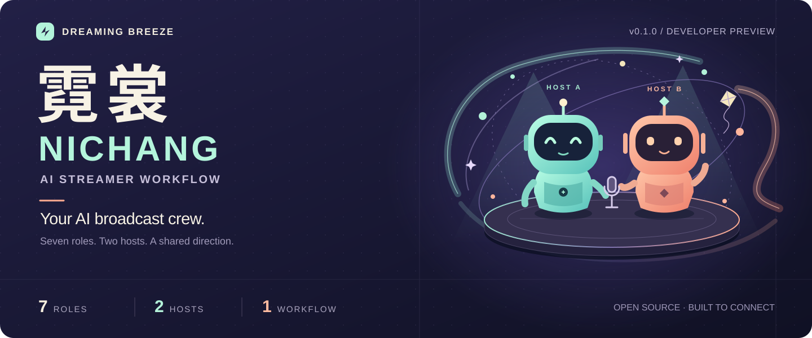

<div align="center">



# 霓裳 · Nichang

**AI Streamer Workflow**

**一键准备 AI 直播团队，让多位 AI 主播协同登场。**

面向从开播到下播全流程自动化的开源工作流套件。

[](https://github.com/XIANYU-HW/ai-streamer-workflow/actions/workflows/verify.yml)
[](LICENSE)
[](https://nodejs.org/en/download)
[](docs/roadmap.md)

**简体中文** · [English](docs/README.en.md)

[快速开始](#快速开始) · [工作室预览](#工作室预览) · [接入指南](packages/runtime/INTEGRATION.md) · [参与贡献](docs/contributing.md)

</div>

> **v0.1.0 · 首个公开预览版 · 持续迭代中**  
> 霓裳仍处于早期开发阶段，目前已发现一些问题，后续会持续修复、补齐接入和改善使用体验。欢迎提交可复现的问题；参见 [已知限制](docs/known-limitations.md) 与 [更新路线图](docs/roadmap.md)。  
> 已提供工作室、七岗位模板、双主播调度核心和离线演示。一次 setup 可以准备应用与岗位提示词；实际 Agent 会话、模型、声音、游戏和直播平台仍需接入。**“无需人工逐步指引完成整场直播”是项目目标，当前版本尚未完成通用端到端直播验收。**

## 把一个直播间，交给一支 AI 团队

直播不只有“让 AI 说话”。游戏操作、主持节奏、观众互动、舞台声音和异常收尾需要配合。这个项目把它们整理成七个明确岗位，让你用自己选择的 AI、角色、游戏与平台，搭建可持续改进的直播团队。

| 组建团队 | 让主播配合 | 建立完整流程 |
| :--- | :--- | :--- |
| 一次准备七岗提示词与 Agent Skill；模型和供应商自由选择 | A/B 双主播配置、轮换玩家、共享语音队列，避免抢话 | 从接入检查、有限演练到运行、恢复与停止，按阶段核对结果 |

## 工作室预览


*当前源码在全新资料目录中的真实界面。初始没有预装角色、声线或直播记录；截图不是直播实录。可在工作室中创建自己的角色与场景。*


*协作流程示意。实线说明岗位分工，外部模型、游戏、语音和平台需要各自接入并验证。工作室与通用运行核心之间也需要集成宿主连接。*

## 快速开始

需要 [Node.js 22.12 或更新版本](https://nodejs.org/en/download)（含 npm）与网络连接。先下载源码并进入目录：

```sh
git clone https://github.com/XIANYU-HW/ai-streamer-workflow.git
cd ai-streamer-workflow
```

然后准备并打开工作室：

```sh
npm run setup
npm run doctor
npm run studio
```

Windows 也可以双击 `Setup-Windows.cmd`；macOS / Linux 可以运行 `sh setup.sh`。首次 setup 下载 Electron 应用依赖、创建 `.local/workflow.json` 和七岗提示词；**不会自动开始游戏、播音或直播**。

`doctor` 会列出尚未接入的模块。新安装显示 `UNCONFIGURED / NOT_VERIFIED` 是正常的待配置状态。重复 setup 会保留你的配置和已修改的 Skill。

只想先看看调度逻辑？不需要模型账号或付费服务：

```sh
npm run setup -- --skip-install
npm run demo
```

这个 demo 使用模拟适配器，演示礼物优先、去重、玩家轮换、局部恢复和停止确认；输出明确标注 `simulated: true`，不会操控真实游戏、播放语音或开播。`--skip-install` 只准备配置，启动图形工作室仍需完整 setup。

## 给团队选好角色，再接上真实世界

1. **选择配置**：编辑 `.local/workflow.json`，设置主播、模型、声线、游戏与输出平台。供应商、模型与推理档位默认留空，密钥通过本机应用安全设置管理。
2. **建立岗位**：让支持 Skill 的 AI 读取 [ai-streamer-workflow/SKILL.md](skills/ai-streamer-workflow/SKILL.md)。setup 生成提示词和计划，客户端拥有建会话工具时才能自动创建实际 Agent；其他客户端可手动使用 `.local/agent-plan/` 的七份提示词。
3. **接入适配器**：按 [接口文档](packages/runtime/INTEGRATION.md) 连接模型决策、游戏观测与输入、语音、观众事件及直播软件，逐项核对真实回执。
4. **完成演练**：先确认游戏响应、声音入节目、画面采集和停止有效，再进行授权范围内的录播或直播。参见 [运行指南](skills/ai-streamer-workflow/references/operation.md)。

可以向你的 AI 提出：

```text
为这个项目创建并配置七个岗位对话，使用我当前选择的 AI 和模型。
先读取项目 Skill，完成接入检查，并列出仍缺的适配器；暂不启动直播。
```

| 岗位 | 负责什么 |
| :--- | :--- |
| 项目统筹 | 目标、配置与跨岗位协调 |
| 直播导播 | 节目节奏、画面与待机切换 |
| 游戏实况执行 | 持有唯一游戏控制权，执行策略与主持协作 |
| 观众互动管理 | 选择弹幕、核验礼物、整理待回应内容 |
| 游戏适配工程师 | 接通具体游戏的观测、输入和反馈 |
| 舞台与声音工程师 | 角色、场景、声线和输出接入 |
| 独立验收 | 按证据核对安装、运行与收尾 |

## 这个版本能做什么

| 部件 | 已提供 | 接入者仍需完成 |
| :--- | :--- | :--- |
| 舞台工作室 | 空白角色库、角色/场景编辑、声音配置与舞台源码 | 角色和动画素材、声线与节目采集 |
| 协作核心 | 单控制租约、单语音队列、礼物优先与去重、轮换、健康与停止状态 | 持续运行宿主和真实适配器 |
| 游戏 | 通用接口与游戏适配专岗 | 每款游戏的观测、输入和实机验证 |
| 互动 | 标准观众事件接口与模拟事件 | 平台允许的真实弹幕/礼物入口 |
| AI / 模型 | 职责、能力要求与建岗模板 | 你选择的客户端/API和实际决策连接 |
| 节目输出 | 舞台与可选节目窗口，不绑定某款直播软件 | 音画路由、平台软件与实际开播/下播验收 |

默认每 15 分钟轮换玩家，两位主播都可以说话；普通弹幕择要回应，可信礼物优先。无弹幕时控制闲聊频率；局部故障由对应岗位恢复，需要大修时切换待机。**用户停止请求优先处理，实际停止结果以回执为准。** 参数可在配置与集成宿主中调整。

核心逻辑的离线检查、桌面界面检查和真实直播是不同的验证层级。具体范围见 [验证状态](docs/verification-status.md) 与 [平台支持](docs/platform-support.md)。当前交付为源码，不含已签名桌面安装器。

## 开发与参与

欢迎贡献真实适配器、平台实测和可复现问题。优先方向见 [路线图](docs/roadmap.md)，步骤见 [贡献指南](docs/contributing.md)。

```sh
npm test                # 离线逻辑检查
npm run check:release   # 源文件与隐私边界检查
npm run release         # 生成干净源码 ZIP、SHA256 和清单
```

```text
apps/       工作室与节目窗口
packages/   调度核心、适配器协议与模拟
skills/     Agent Skill、七岗职责与运行指引
config/     不绑定供应商的默认配置
docs/       架构、验证范围与贡献说明
```

[架构](docs/architecture.md) · [验证方法](skills/ai-streamer-workflow/references/verification.md) · [源码打包说明](docs/release.md) · [提交问题](https://github.com/XIANYU-HW/ai-streamer-workflow/issues/new/choose)

## 许可证

本项目原创代码与文档采用 [MIT License](LICENSE)。第三方依赖保留各自许可，详见 [第三方说明](THIRD_PARTY_NOTICES.md)。角色、声音、模型与平台服务由使用者自行选择，其授权分别适用。

<div align="center">

由 [清风作梦 · Dreaming Breeze](https://github.com/XIANYU-HW) 发起  
**让每个想象中的直播间，都有机会成为现实。**

</div>
