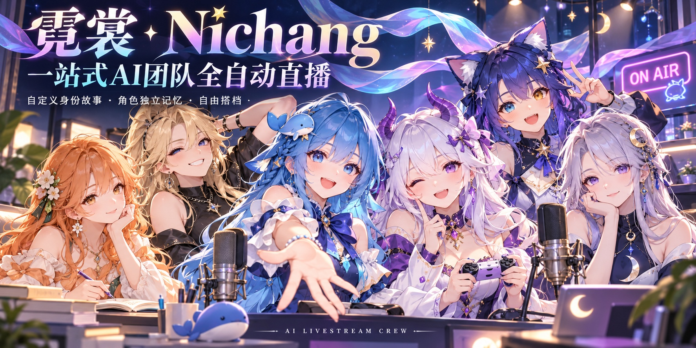
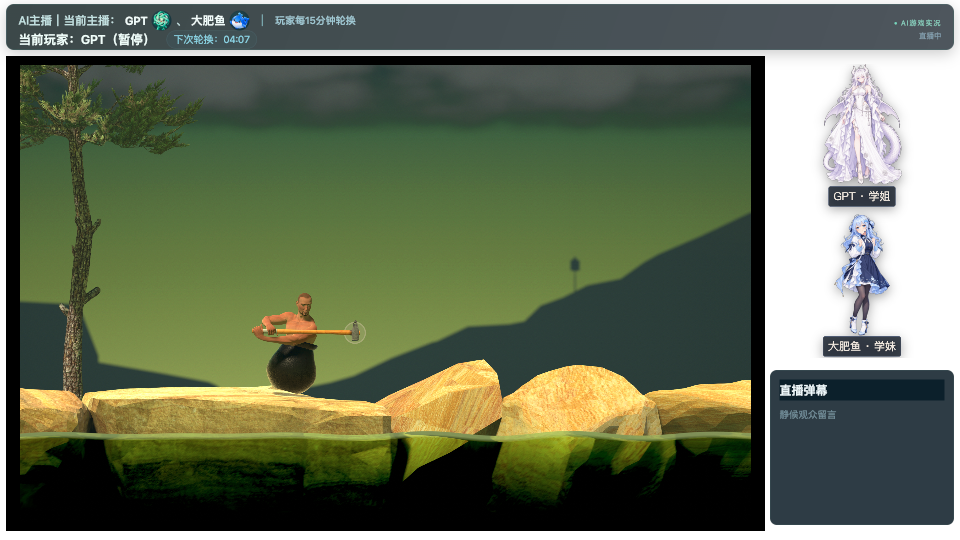
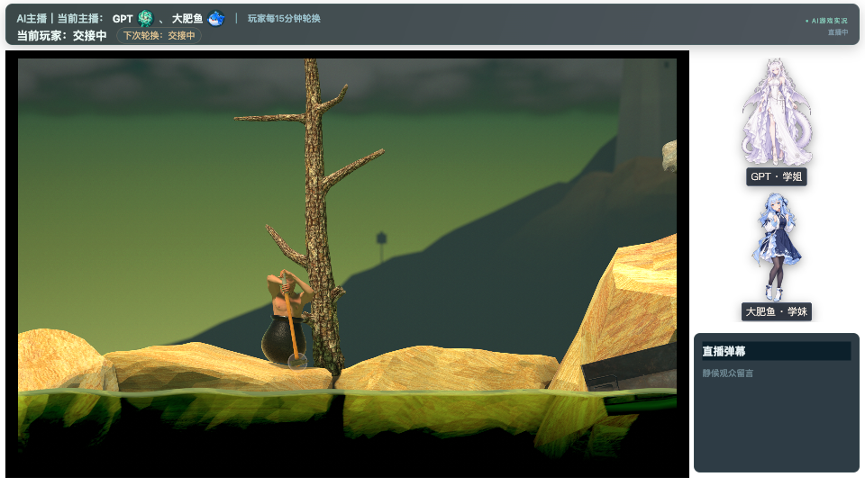
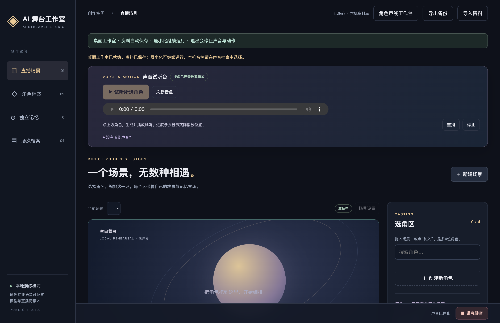
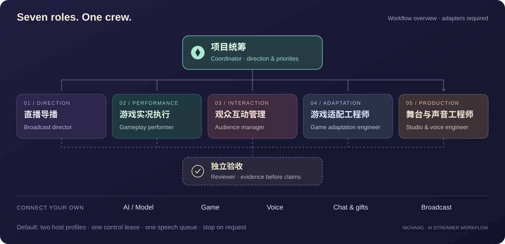

<div align="center">



# Nichang · 霓裳

**AI Streamer Workflow**

**Your all-in-one AI team for automated livestreaming.**

Give your hosts their own backstories, lasting memories, and a changing cast of companions.

[](https://github.com/XIANYU-HW/ai-streamer-workflow/actions/workflows/verify.yml)
[](../LICENSE)
[](https://nodejs.org/en/download)
[](roadmap.md)

[简体中文](../README.md) · **English**

[Quick start](#quick-start) · [Live showcase](#real-livestream-showcase) · [Characters & memory](#characters-with-stories-memories-and-companions) · [Studio](#studio-preview) · [Integration guide](../packages/runtime/INTEGRATION.md) · [Contribute](contributing.md)

</div>

<sub>The cover is an AI-generated ensemble of community-inspired GPT, DeepSeek, Claude, Gemini, Grok, and Kimi personifications. Characters are not bundled with the source. See [visual notes](showcase.md).</sub>

> **v0.1.0 · First public preview · Under active development**
> Includes a character studio, separate memory records, seven role templates, and a broadcast coordination core. Known issues remain, and real models, voices, games, and platforms require integration. Fully autonomous end-to-end broadcasts remain a development goal. [Known limitations](known-limitations.md) · [Roadmap](roadmap.md)

## Characters with stories, memories, and companions

Build a cast with individual histories and personalities, then let them share the stage.

| 🎭 Custom identities and backstories | 📖 Lasting memories for each character | ✨ Mix and match your cast |
| :--- | :--- | :--- |
| Define every host's name, backstory, personality, appearance, forms of address, and voice | Keep confirmed experiences in separate character records and carry them into later sessions | Reuse characters across scenes and partnerships while preserving their identity and memories; stage up to four characters per session |

**Give your cast a history.** Save, export, and restore characters, scenes, sessions, and memories locally. Each new session can include that character's confirmed past; a companion's private backstory and memories are not automatically shared.

*Current memory flow: record session events → create drafts for characters who witnessed them → confirm → include in later session context. Automatic capture from real livestreams, memory extraction, and model responses still require integration. The default broadcast template uses two hosts; four-person casting is a studio feature.*

## Real livestream showcase

**GPT and DeepSeek take on Getting Over It.** These frames were saved during the project's early public trial stream on October 29, 2026, preserving the real game and character layout.



*After game recovery, 03:55 New York time. The top bar visibly shows GPT paused.*

<details>
<summary><b>Another frame: the two hosts at the first tree</b></summary>



*04:26 New York time. The top bar shows a handoff in progress. No elements were redrawn or replaced.*

</details>

*Captured from the internal integrated programme output while the public stream was active. This is not an out-of-the-box result of the public v0.1.0 package, which requires adapters. The frames do not verify viewer-side delivery, audience replies, or autonomous end-to-end operation. [Media provenance and scope](showcase.md)*

## A crew for the whole show

Gameplay, hosting, audience responses, stage production, and shutdown need to work together. Nichang separates these responsibilities into seven roles, while leaving the AI, characters, game, and platform up to you.

| Prepare a team | Coordinate hosts | Connect the workflow |
| :--- | :--- | :--- |
| Setup prepares the apps, seven role prompts, and an Agent Skill | Default A/B hosts, player rotation, and one shared speech queue | Integration checks, rehearsals, operation, recovery, and shutdown evidence |

## Studio preview



*Captured from the current source with a fresh local data directory. No characters, voices, or broadcast history are bundled. This is a product interface preview, not a live broadcast recording.*



*Workflow illustration. External models, games, voices, and platforms require their own adapters and verification. The studio and generic runtime also need an integration host to connect them.*

## Quick start

Install [Node.js 22.12 or newer](https://nodejs.org/en/download), including npm. An internet connection is needed to download application dependencies.

```sh
git clone https://github.com/XIANYU-HW/ai-streamer-workflow.git
cd ai-streamer-workflow
npm run setup
npm run doctor
npm run studio
```

On Windows, you can also double-click `Setup-Windows.cmd`. On macOS/Linux, run `sh setup.sh`. Setup installs Electron dependencies and creates `.local/workflow.json` and the role plan. It does not start games, speech, recording, or broadcasting. Re-running it preserves existing configuration and modified skills.

A fresh `doctor` report will show adapters as `UNCONFIGURED / NOT_VERIFIED` until you connect them.

For a finite offline demo without downloading the desktop runtime:

```sh
npm run setup -- --skip-install
npm run demo
```

The demo exercises gift priority, deduplication, player rotation, component recovery, and stop confirmations using simulated adapters. Its output explicitly includes `simulated: true`; it does not play real games, generate speech, or start a broadcast. A full setup is still needed to launch the studio.

## Connect your crew

1. Configure your hosts, models, voices, game, and output platform in `.local/workflow.json`. Providers, model names, and reasoning settings start unset. Keep credentials in the application's local secure settings.
2. Ask a compatible AI client to read [SKILL.md](../skills/ai-streamer-workflow/SKILL.md). Setup creates prompts and a plan, not active agents. Clients with session-creation tools can create the roles and record receipts; otherwise use the seven prompts in `.local/agent-plan/` manually.
3. Implement the actual model, game, speech, audience-event, and broadcast adapters using the [integration contract](../packages/runtime/INTEGRATION.md).
4. Verify gameplay responses, audio in the programme output, capture, and shutdown before an authorized recording or broadcast. Follow the [operation guide](../skills/ai-streamer-workflow/references/operation.md).

Example request to your AI client:

```text
Read this project's Skill and prepare the seven role sessions using my chosen AI
and models. Check the integrations and list missing adapters. Do not start a broadcast yet.
```

| Role | Responsibility |
| :--- | :--- |
| Coordinator | Goals, configuration, and cross-role decisions |
| Broadcast director | Programme pacing, output, and standby transitions |
| Gameplay performer | Exclusive game control and coordinated hosting |
| Audience manager | Select comments and verify gift events |
| Game adaptation engineer | Connect game observations, inputs, and feedback |
| Studio and audio engineer | Characters, scenes, voices, and output routing |
| Independent reviewer | Verify evidence at each stage |

## What is included

| Component | Available now | Still required |
| :--- | :--- | :--- |
| Studio | Character backstories, scene editing, up to four-character staging, separate voice settings | Your assets, voices, animations, and capture setup |
| Character memory | Per-character isolation, draft review, cross-session context, local storage and backup | Live event capture, automatic extraction, and model integration |
| Runtime | Exclusive control lease, one speech queue, gift priority/deduplication, rotation, health, stop state | Persistent integration host and real drivers |
| Games | Adapter contract and a dedicated role | Per-game observation, input, and real-device tests |
| Audience | Standard event contract and simulated events | Permitted platform event sources and real gift verification |
| AI/models | Role templates and capability requirements | Selected client/API and actual decision integration |
| Programme output | Studio and optional output window | Audio/video routing, platform software, and broadcast verification |

The default player rotation is 15 minutes. Both hosts can speak; ordinary comments are selected rather than answered exhaustively, while trusted gifts receive priority. Local failures can be recovered without resetting the programme clock. Major repairs use standby output. User stop requests take precedence.

See [verification status](verification-status.md) and [platform support](platform-support.md) for the tested scope. Offline logic tests do not establish real platform streaming. This repository ships source, not signed desktop installers. Most detailed implementation guides currently use Chinese.

## Develop and contribute

Real adapters, platform testing, and reproducible bug reports are especially useful. Read the [roadmap](roadmap.md) and [contribution guide](contributing.md).

```sh
npm test
npm run check:release
npm run release
```

The release command produces a clean source ZIP, SHA256 checksum, and file manifest. Local data, credentials, recordings, and dependencies are excluded.

[Architecture](architecture.md) · [Verification](../skills/ai-streamer-workflow/references/verification.md) · [Packaging](release.md) · [Report an issue](https://github.com/XIANYU-HW/ai-streamer-workflow/issues/new/choose)

## License

Original project code and documentation are released under the [MIT License](../LICENSE). Third-party dependencies retain their own licenses; see [third-party notices](../THIRD_PARTY_NOTICES.md). Models, character assets, voices, and platform services have separate terms.

<div align="center">

Created by [清风作梦 · Dreaming Breeze](https://github.com/XIANYU-HW)

</div>
