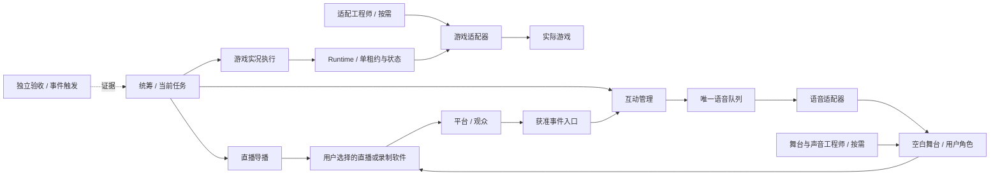

# 架构与接入边界

图中的外部连线是待接入的接口，不表示源码已完成所有平台实现。Studio 的本地服务与通用 runtime 是独立模块；实际 integration host 应按各自接口连接，不能仅启两个进程就声称接通。`packages/runtime/INTEGRATION.md` 定义核心 API，`apps/studio/` 的接口文档定义舞台入口。

## 执行层

本地适配器负责高频动作和释放输入，模型异步提出策略。只有持租约的执行者可发游戏动作；有效动作回执仍不等于实际游戏效果。模型、输入、声音、互动、画面和录制分别有健康状态，不因一个故障重启全链路。纯核心不会读取键盘、屏幕、账户或打开直播。

Runtime state 是当前控制/队列状态的唯一来源，使用原子写入及进程排他锁。启动多个进程不产生多份有效控制权；崩溃恢复需核对实际输出和输入状态。未知播放回执不盲目重播。状态和日志只写新建的本地目录。

## 配置边界

`.local/workflow.json` 是面向人的配置；integration host 须将其转为 runtime API 参数：hosts 的 id 对应 players，rotation.intervalSeconds 对应 rotationSeconds，cost.paidEnabled/limitUSD 对应 paidEnabled/spendingCapUSD。未实现适配器保持 null，不能自动改成 simulated 来通过真实验收。默认模型与档位 null 表示用户选择，不是固定模型别名。

舞台数据与控制运行数据隔离。使用者主动创建角色和记忆后才有资料，包中没有模板作者的人物、语音样本或权限。安全存储/供应商 API 是可选能力，需要在用户设备上配置。

## 通信与恢复

常规消息只到实际消费者；统筹接收需要决策或跨模块协调的结果。导播不控制游戏，互动不直接播音，适配工程师交付后待命，验收按需运行。跨模块修复先约定唯一作者；局部恢复不清节目时钟，不清礼物去重记录。

“保持节目继续”以输入可释放、用户未要求停止等条件为前提。需要大修时展示用户配置的待机画面，并保持健康输出；不能覆盖用户停止。首次失败原因保留，后来的正常 stop 不得伪装首因。
